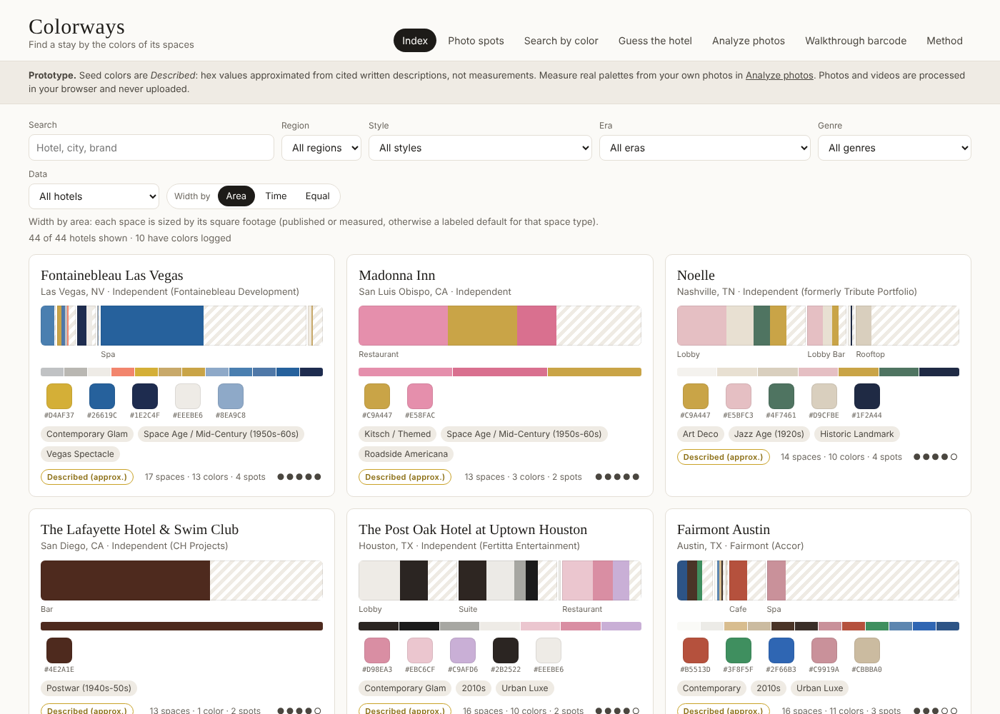
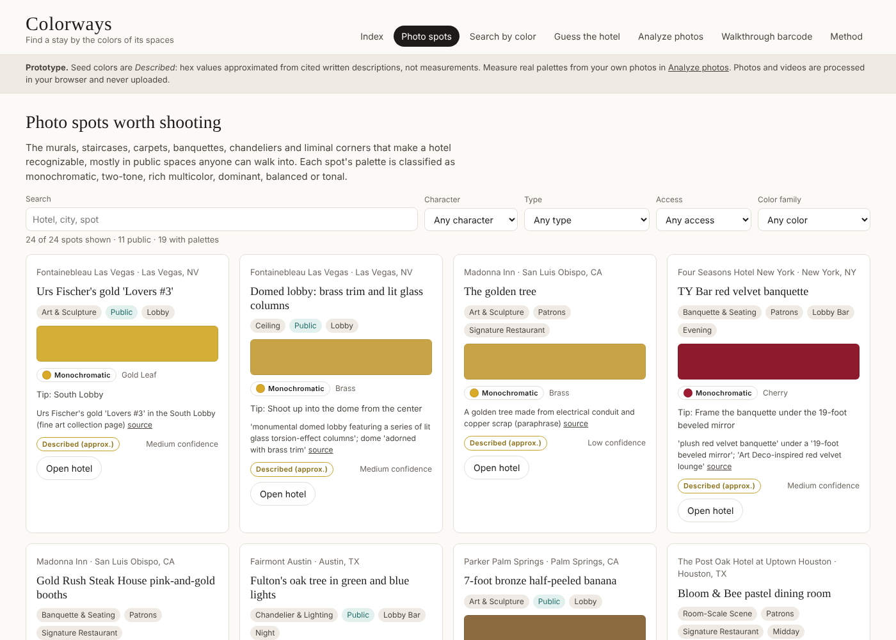
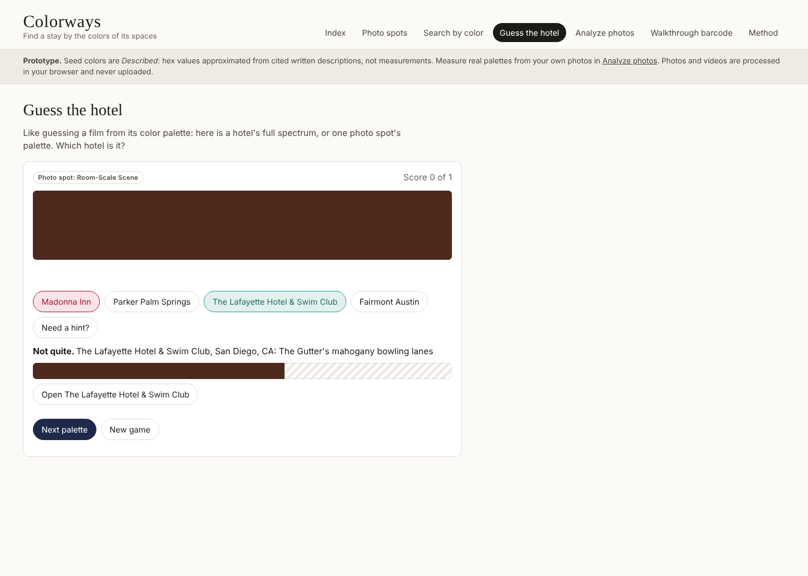
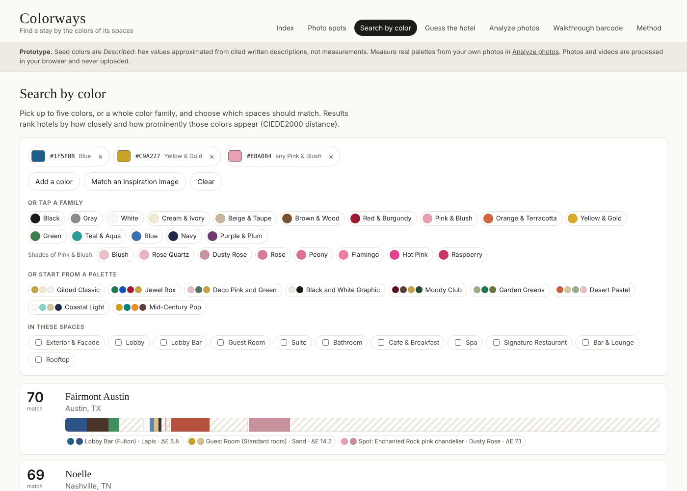
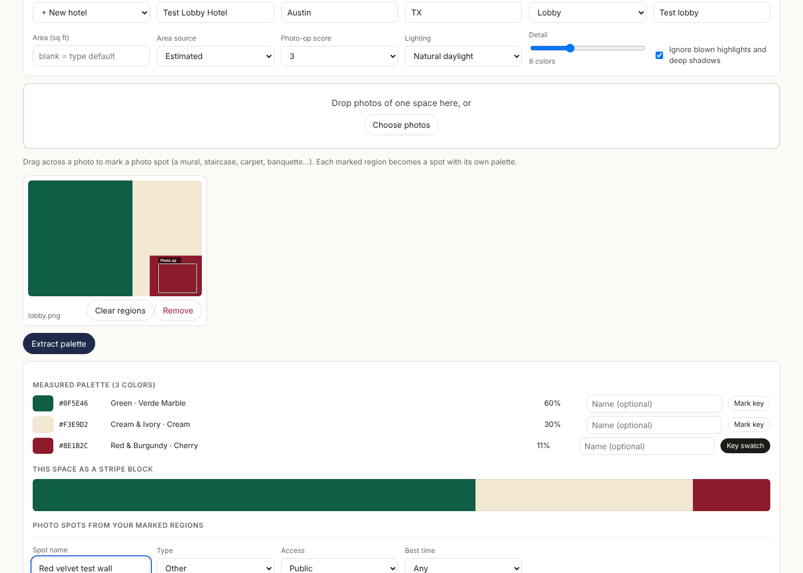
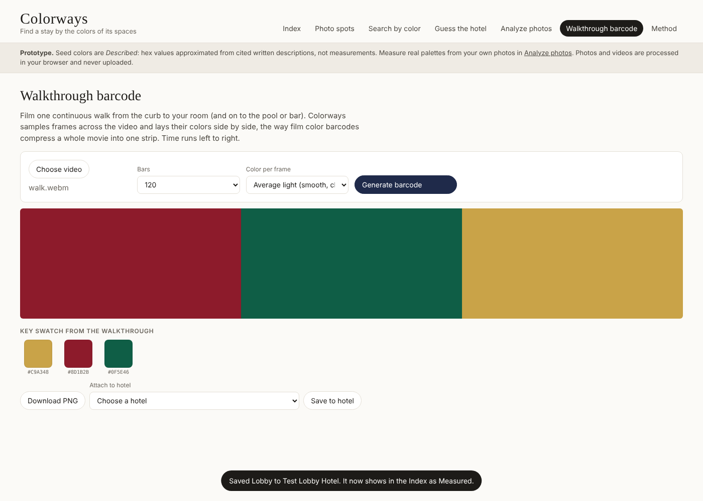
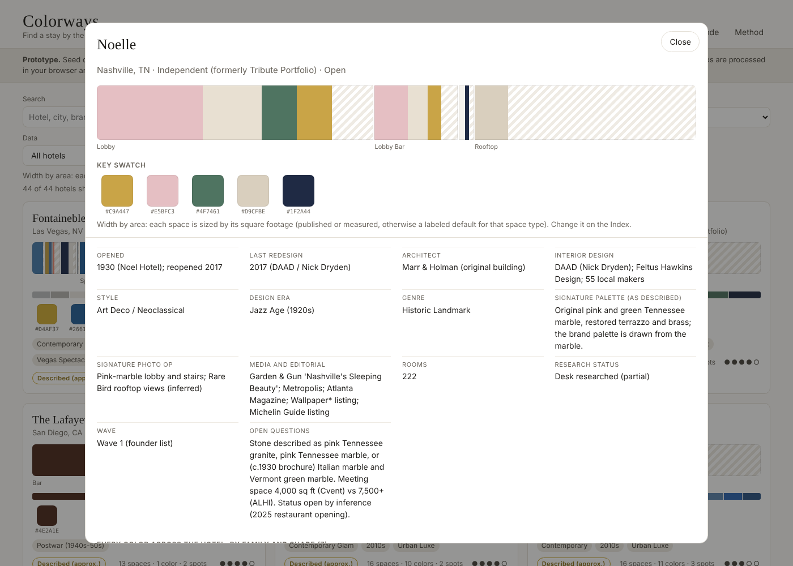

# Colorways

Find a stay by the colors of its spaces. Colorways turns each hotel into a **hotel stripe**: its key spaces laid out in stay order (arrival, lobby, bar, room, bath, pool, spa, dinner, drinks), sized by square footage or time, and filled with each space's colors. A **spectrum** shows every color across the hotel with named shades (sage, emerald, forest...), a five-chip **key swatch** gives the simplified read, and **photo spots** surface the murals, staircases, carpets and liminal corners worth shooting, each classified as monochromatic, two-tone, rich multicolor and so on. Think climate warming stripes and film color barcodes, applied to hotels.



## What is here

```
app/                 Web prototype (plain HTML/CSS/JS, no build step, works offline)
  index.html         Open this in a browser
  js/color.js        CIELAB, CIEDE2000, color families
  js/kmeans.js       Palette extraction from photos and video frames
  js/model.js        Hotel stripe, key swatch, coverage, color search
  js/app.js          UI: Index, Photo spots, Search, Guess the hotel, Analyze photos, Walkthrough barcode, Method
  data/seed.js       Generated from data/ (do not edit)
data/
  vocab.json         Space types, styles, eras, genres, moods and other lists
  seed/hotels.json   Seed dataset: 44 hotels, 24 photo spots, 12 motifs, sourced and labeled
deliverables/
  Colorways_Hotel_Color_Index.xlsx   The working spreadsheet (generated)
docs/
  PLAN.md            Feasibility and build plan (v0.3)
  CONCEPT.md         The hotel stripe, from first principles, plus content strategy
  CAPTURE_PROTOCOL.md  How to shoot hotels for measurable color
  DATA_DICTIONARY.md   Every sheet and column (generated)
  RESEARCH_2026-10.md  What was verified, what was not, and the next research pass
  screenshots/
tools/
  build.py           Builds app/data/seed.js, the workbook and the data dictionary
  colorlib.py        Python color science (reference for the JS and Excel versions)
tests/               Unit, parity and end-to-end tests
```

## Quick start

- **Use the prototype:** open `app/index.html` in Chrome, Safari or Edge (double-click works). Photos and videos you analyze stay in your browser.
- **Use the spreadsheet:** open `deliverables/Colorways_Hotel_Color_Index.xlsx`. Start with the README tab. Yellow headers are inputs, gray headers calculate.
- **Rebuild after editing the seed or vocab:** `python3 tools/build.py` (needs Python 3 and openpyxl).
- **Host it:** with GitHub Pages enabled on this repo (Settings, Pages, deploy from the main branch, root folder), the site opens at the Pages URL and redirects to `app/`.

## Tests

```
node --test "tests/*.test.js"                         # color math, clustering, stripe, character, shades (26 tests)
python3 -m unittest discover -s tests -p "test_*.py"  # JS/Python parity, CSV columns, seed rules (12 tests)
node tests/e2e_smoke.js photo.png clip.webm docs/screenshots   # full browser run (needs Playwright)
```

The workbook's formulas were also recalculated in LibreOffice (43,000 formulas, zero errors) and compared with the JavaScript model: every seed swatch matches, stripe shares agree to within 1e-15, and every spot's color character matches in Excel, Python and JavaScript.

## Data honesty

Every seeded color is **Described**: a hex approximated from a cited written description, checked to land in the color family the text names, with a confidence level and a coverage estimate (how much of the space the description covers). None are measurements yet. **Measured** colors come from your own calibrated photos through the Analyze tab. See docs/RESEARCH_2026-10.md for what was verified and what was not.

| Photo spots | Guess the hotel | Search by color |
|---|---|---|
|  |  |  |

| Analyze photos | Walkthrough barcode | Hotel detail |
|---|---|---|
|  |  |  |
